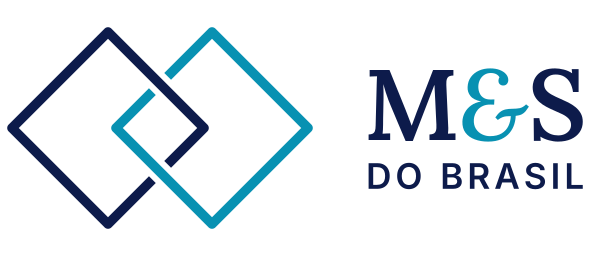

<picture>
  <source media="(prefers-color-scheme: dark)" srcset="ms-do-brasil-horizontal-escura.svg">
  
</picture>

# Guia de marca — M&S do Brasil

Resumo operacional do **Estudo de marca v0.4** (novembro de 2026) para uso em
README, documentação e telas dos repositórios.

> **Status:** proposta em validação. O estudo declara que nada é identidade
> oficial antes da aprovação; emblema, descritor e prova de cor seguem em
> aberto. Se o desenho mudar, basta trocar os arquivos desta pasta — os
> documentos apontam para eles.

## Arquivos

| Arquivo | Uso |
|---------|-----|
| `ms-do-brasil-horizontal-clara.svg` | Assinatura principal em fundo claro (cabeçalho de README, documentos, propostas) |
| `ms-do-brasil-horizontal-escura.svg` | Assinatura principal em fundo escuro (marinho ou tema escuro) |
| `ms-do-brasil-horizontal-uma-cor.svg` | Uma cor (marinho), para impressão ou fundo que não aceita o ciano |
| `ms-do-brasil-emblema-clara.svg` · `-escura.svg` | Emblema com as iniciais, a partir de 48 px de altura |
| `ms-do-brasil-icone.svg` | Avatar (GitHub, LinkedIn, WhatsApp) |

Os SVG foram construídos na grade do estudo (80 × 64: losangos de 48 de altura,
centros a 26, traço de 2,4, vão de 1,5 no cruzamento) e o texto já está
convertido em curvas — não dependem de fonte instalada.

**Ainda não há arquivo** para o ícone reduzido (abaixo de 64 px) nem para o
favicon de 16 px: o estudo prevê desenho próprio para cada um.

### No README (troca automática claro/escuro)

```html
<picture>
  <source media="(prefers-color-scheme: dark)" srcset="docs/brand/ms-do-brasil-horizontal-escura.svg">
  
</picture>
```

## Cores

| Nome | HEX | Uso |
|------|-----|-----|
| Marinho M&S | `#0D1B4B` | Cor principal: primeiro losango, nome, fundos escuros |
| Azul M&S | `#1D4ED8` | Ação e destaque: botões, links, títulos de seção |
| Ciano elo | `#06B6D4` | Segundo losango e `&` **sobre fundo escuro**; nunca em texto sobre branco |
| Ciano elo claro | `#0891B2` | Segundo losango e `&` **sobre fundo claro**; só em gráficos e texto de 24 px ou mais |
| Tinta | `#0B1533` | Títulos |
| Texto | `#35425E` | Corpo |
| Apoio | `#5F6C88` | Legendas e rótulos |
| Linha | `#DDE5F2` | Bordas e divisórias |
| Névoa | `#F4F7FC` | Fundo de cartões |

**Vermelho fica de fora**, inclusive como cor de destaque, para manter distância
visual da Oracle.

Badges (shields.io) usam o HEX sem `#`: marinho para tecnologia, ciano claro
para testes, azul para versão, apoio para licença.

## Tipografia

| Família | Papel | Substituta |
|---------|-------|------------|
| **Lora** (SemiBold; `&` em itálico) | Nome e títulos institucionais | Georgia, Cambria |
| **Inter** | Títulos de tela e texto | Calibri, Arial |
| **JetBrains Mono** | Código e rótulos | Consolas |

As três são distribuídas sob a SIL Open Font License.

## Regras de uso

- **Área de proteção:** margem livre de meia altura do losango em volta da
  assinatura. Nenhum texto, imagem, borda ou outra marca entra nela.
- **Redução mínima:** horizontal 40 px de altura; emblema 48 px. Abaixo disso,
  ícone reduzido e, por fim, favicon.
- **Não fazer:** esticar ou comprimir; trocar o ciano por outra cor; escrever o
  nome em outra fonte; girar ou inclinar; aplicar a versão clara sobre fundo
  escuro ou colorido; aplicar sombra, contorno ou degradê; separar os losangos
  ou desfazer o entrelaçado.

## Tom de voz

A marca é **técnica, direta e confiável**.

- Fala com precisão e mostra o código, o comando ou o arquivo.
- Sem adjetivo sobrando nem promessa vaga.
- Títulos sem emoji; marcas de status em tabela (✅ / ⬜) são dado, não enfeite.
- "Desenvolvimento de sistemas" é texto de apoio, fora do logotipo. O nome
  Oracle não entra na assinatura.

## Família de marcas

M&S do Brasil, Cobrança-API e PyCobrança compartilham o par marinho e ciano e o
desenho geométrico. A empresa fica com o traço fino e a serifa; os produtos,
com formas cheias e diretas.
